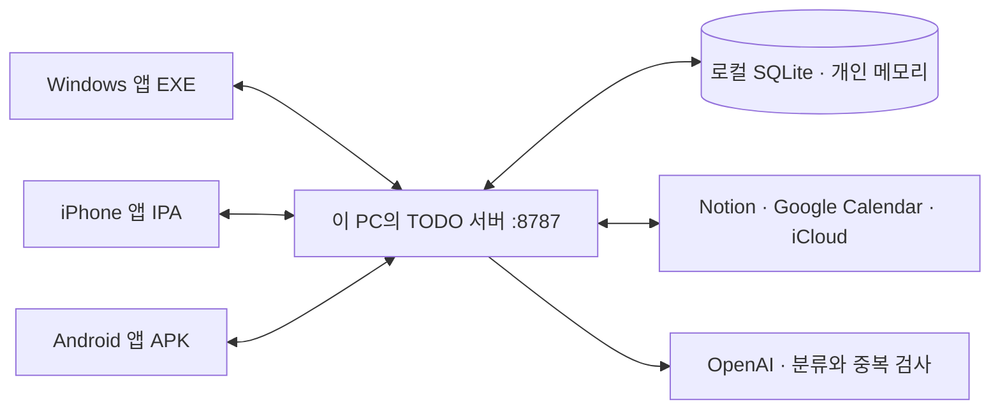

# 데모 계정, 설치 파일 구조와 실행 방법

> [모바일 1.1.2 안내](uiux-1.1.2.md): 서버 비밀번호로 직접 로그인하며 PC 앱과 6자리 코드가 필수는 아니다. iOS 최신 빌드는 7, Android 최신 버전 코드는 5다. 아래 1.1.1의 모바일 설치 정보는 이전 버전이며 PC 앱 1.1.1은 계속 사용한다.

## 현재 컴퓨터의 설정

- OpenAI API 키는 `server/.env`에 저장한다. Git, APK, IPA, EXE, 배포용 서버 ZIP에는 포함하지 않는다.
- `PUBLIC_URL=http://localhost:8787`로 설정한다. Google/Notion OAuth 연결은 PC 앱에서 진행한다.
- 서버는 이 PC 한 대에서 실행한다. 휴대폰도 같은 서버를 사용하되 PC의 Wi-Fi IP로 접속한다.
- Expo 프로젝트는 `teamblco` 조직의 [`todo-checker`](https://expo.dev/accounts/teamblco/projects/todo-checker)에 연결했다. 로그인 사용자는 `teamblackcoconut`이며 조직 Owner 권한이 있다. 프로젝트 ID는 `338b53aa-b90b-4756-96dd-38fe1f73e026`이다. 현재 저장소에서는 `eas init`을 다시 실행할 필요 없다.
- Apple 개발자 팀은 `Jeongwon Bae (Individual)`, Team ID는 `F6A6QXBZAM`이다. 촬영할 iPhone 1대가 등록되었고 `com.todochecker.app`의 배포 인증서와 Ad Hoc 프로비저닝 프로파일을 생성했다. 기존 기기로 다시 빌드할 때 기기 등록을 반복할 필요 없다.
- iPhone IPA는 버전 `1.1.1`/빌드 `6`, 최소 iOS `16.4`이며 [EAS 설치 페이지](https://expo.dev/accounts/teamblco/projects/todo-checker/builds/b57eeefc-aadc-48c4-87d9-1f0d6e8f86cb)를 등록한 iPhone의 Safari에서 열어 설치한다. 파일은 `artifacts/demo-2026-09-14-v1.1.1/todo-checker-demo-1.1.1-ios.ipa`에 있다. 현재 설치에는 아래의 Expo 초기화·기기 등록·빌드 단계를 반복할 필요 없다.
- 현재 개인용 구성은 앱별 로그인 대신 같은 서버 토큰을 사용한다. 여러 사람에게 공용 서버로 공개할 때는 사용자별 인증과 데이터/연결 소유자 구분을 추가해야 한다.

## 계정마다 맡는 역할

각 서비스의 계정 이메일을 모두 맞출 필요는 없다.

| 계정 | 어디서 로그인하는가 | 역할 | 다른 계정과 같아야 하나? |
|---|---|---|---|
| Google 개발용 계정 A | Google Cloud Console | 프로젝트·OAuth 클라이언트 관리 | 캘린더 계정 B와 달라도 됨 |
| Google 데모 계정 B | PC 앱의 Google 연결 화면 | 자신의 캘린더 접근을 승인 | A의 OAuth 테스트 사용자 목록에 B를 등록 |
| Expo 계정 X | `eas login`, expo.dev | 빌드 프로젝트와 빌드 결과 관리 | Apple·Google 이메일과 달라도 됨 |
| Apple 개발자 계정 D | EAS에서 Apple 로그인을 요청할 때 | 유료 멤버십의 팀·서명 인증서·기기 등록 | 유료 멤버십이 연결된 계정을 사용 |
| iPhone에 로그인된 Apple 계정 E | iPhone 설정/App Store | 기기 사용과 App Store 앱 설치 | Ad Hoc 설치 허용은 등록된 기기 UDID로 결정됨 |
| iCloud Calendar 계정 C | TODO 앱의 Apple Calendar 연결 | 일정 데이터 접근 | 앱 서명용 개발자 계정 D와 별개의 용도 |
| OpenAI 프로젝트 | 서버 `.env` | AI 분류·중복 검사의 키와 비용 | 모바일 사용자가 OpenAI에 로그인할 필요 없음 |

Google 테스트 모드에서는 실제로 연결할 계정을 테스트 사용자로 추가한다. [Google 테스트 사용자 안내](https://developers.google.com/identity/protocols/oauth2/production-readiness/sensitive-scope-verification)

Apple 개인 개발자 계정은 Account Holder가 서명 자격 증명을 생성한다. 조직 멤버십이면 Account Holder 또는 Admin을 쓰는 것이 명확하다. 다른 역할은 Certificates, Identifiers & Profiles 접근 권한을 확인해야 한다. [EAS의 Apple 계정 권한 안내](https://docs.expo.dev/app-signing/apple-developer-program-roles-and-permissions/)

## Google: 개발 계정 A와 캘린더 계정 B가 다를 때

1. **계정 A**로 [Google Cloud Console](https://console.cloud.google.com/)에 로그인한다.
2. 이 앱용 프로젝트를 선택하고 **Google Calendar API**를 활성화한다.
3. **Google Auth Platform**에서 Branding에 앱 이름·지원 이메일·개발자 연락처를 입력한다.
4. Audience는 외부 사용자용으로 설정하고, 게시 상태는 **Testing**으로 둔다.
5. **Test users에 계정 B의 Google 이메일**을 추가한다. A로도 실제 캘린더 연결을 테스트할 예정이면 A도 추가한다.
6. Data Access에서 앱이 요청하는 캘린더 목록 읽기와 일정 읽기·쓰기 권한을 확인한다. 현재 코드의 범위는 `openid`, `email`, `https://www.googleapis.com/auth/calendar.calendarlist.readonly`, `https://www.googleapis.com/auth/calendar.events`다.
7. Clients에서 **Web application** OAuth 클라이언트를 만든다. iOS/Android 클라이언트가 아니라 서버에서 코드를 교환하는 웹 클라이언트다.
8. Authorized redirect URI에 `http://localhost:8787/oauth/google/callback`을 정확히 등록한다.
9. Client ID와 Client Secret을 PC의 `server/.env`에서 `GOOGLE_CLIENT_ID`, `GOOGLE_CLIENT_SECRET`에 입력하고 서버를 재시작한다.
10. **PC TODO 앱 → 도구 연결 → Google Calendar → Google 계정 연결**을 누른다. 브라우저에서는 **캘린더가 있는 계정 B**를 선택한다.
11. 권한 승인 후 앱으로 돌아와 B의 계정에서 위치 선택 → 데모 캘린더 선택 → 조직 지정 → 저장한다.

A에게 B 캘린더를 별도로 공유할 필요는 없다. 앱은 B가 발급받은 사용자 토큰으로 B의 캘린더에 접근한다. 기업 Workspace 계정이면 조직 관리자의 외부 앱 정책이 별도로 적용될 수 있다.

## iPhone: 유료 Apple 멤버십을 이미 가진 경우

### 1. 어떤 Apple 계정을 쓸지 확인

[Apple Developer Account](https://developer.apple.com/account/)에 **유료 멤버십을 보유한 Apple 계정 D**로 로그인한다. 멤버십이 활성 상태인지 확인하고 팀 이름과 Team ID를 기록한다. 여러 팀이 보이면 이 앱을 소유할 본인 팀을 선택한다. 개인 가입이라면 보통 본인 이름의 팀이다.

이후 EAS가 Apple 로그인을 요청하면 이 **계정 D의 Apple 로그인 정보와 2단계 인증**을 사용한다. iCloud 캘린더 연결에서 만든 앱 전용 암호를 서명용 로그인에 입력하는 것이 아니다. 로그인 정보와 인증 코드는 터미널/공식 화면에 직접 입력한다.

### 2. Expo 계정 선택과 로그인

Expo 계정 X는 Apple 계정 D와 다른 서비스다. 이미 쓰는 본인 Expo 계정이 있으면 그것을 쓰고, 없으면 [Expo 가입](https://expo.dev/signup)으로 만든다. 개인 데모에서는 회사 Organization을 새로 만들 필요 없이 본인의 Expo 계정으로 관리해도 된다.

VS Code 터미널을 프로젝트 루트에서 열어 실행한다.

```powershell
cd mobile
npx eas-cli@latest login
npx eas-cli@latest whoami
```

`login`에는 **Expo 계정 X**를 입력한다. `whoami`에 의도한 Expo 사용자명이 나오는지 확인한다.

### 3. 이 소스를 Expo 프로젝트에 연결

현재 저장소는 이미 `@teamblco/todo-checker`에 연결되어 있으므로 이 단계는 건너뛰고 iPhone 등록부터 진행한다. 아래 명령은 연결되지 않은 별도 복사본을 설정할 때의 안내다.

```powershell
npx eas-cli@latest init
```

프로젝트를 만들거나 연결할지 물으면 기존에 이 앱용으로 만든 프로젝트가 있는지 확인한다. 처음이면 본인 Expo 계정 X 아래 새 프로젝트를 만든다. 완료되면 `app.json`의 `extra.eas.projectId`에 실제 프로젝트 ID가 기록된다. 임의의 UUID를 만들어 넣지 않는다.

현재 iOS Bundle Identifier는 `com.todochecker.app`이다. 본인 Apple 팀에서 사용할 수 있으면 유지한다. 다른 소유자에게 이미 등록된 식별자라는 오류가 나오면 본인 소유의 고유한 번들 ID로 변경하고 이후 같은 값을 계속 사용한다.

### 4. 촬영할 실제 iPhone 등록

`iTunes service key is empty` 오류가 발생하면 아래의 **Apple 로그인 준비 오류** 절을 먼저 따른다. 현재 확인된 EAS 24.3.0에서는 `npm run apple:register`로 임시 우회할 수 있다.

```powershell
npx eas-cli@latest device:create
```

Apple 로그인 요청에는 **계정 D**로 로그인하고, 앞서 확인한 Apple 팀을 선택한다. 등록 방식으로 Website를 선택하면 등록 URL/QR이 제공된다. **촬영할 iPhone의 Safari**로 열고 기기 등록 안내를 진행한다. 기기 식별용 프로파일 설치가 표시되면 iPhone 설정에서 확인한 뒤 설치를 완료한다.

```powershell
npx eas-cli@latest device:list
```

방금 등록한 iPhone이 올바른 팀의 기기 목록에 있는지 확인한다. 다른 기기로 열었다면 그 다른 기기가 등록된다. Ad Hoc 프로비저닝 프로파일에는 빌드 시 허용할 기기의 UDID가 포함된다. [Expo 내부 배포](https://docs.expo.dev/build/internal-distribution/)

### 5. IPA 빌드와 서명

```powershell
npm run build:demo:ios
```

명령은 `eas build --platform ios --profile demo`를 실행한다. 다음 기준으로 선택한다.

| 질문/설정 | 선택 기준 |
|---|---|
| Expo project / owner | 앞서 선택한 Expo 계정 X의 프로젝트 |
| Apple 로그인 | 유료 멤버십 계정 D |
| Apple Team | 앞서 확인한 팀 이름·Team ID |
| Distribution certificate | 이 팀의 유효한 기존 인증서가 있으면 재사용, 없으면 생성 |
| Provisioning profile | 현재 앱과 촬영할 iPhone이 포함된 Ad Hoc 프로파일 생성/갱신 |
| 포함할 기기 | `device:create`로 등록한 촬영용 iPhone |

이 데모 프로필은 **Release + internal distribution + 실제 iPhone**이다. iOS Simulator용 빌드가 아니며 Metro 서버 없이 앱이 실행된다. App Store Connect 앱 생성이나 `submit.production.ios`의 `REPLACE_WITH_...` 값은 이번 내부 배포에 필요하지 않다. 해당 값은 나중에 TestFlight/App Store 제출 시 사용한다.

### 6. iPhone에 설치

빌드가 완료되면 EAS 빌드 페이지에서 IPA를 다운로드할 수 있다. iPhone Safari로 해당 빌드의 **Install** 링크를 열어 앱을 설치한다. 파일 앱에 IPA를 복사하는 것만으로 설치되는 것은 아니다.

개발자 모드를 요구하면 **설정 → 개인정보 보호 및 보안 → 개발자 모드**에서 활성화하고 재부팅한 뒤 확인한다. 앱의 **로컬 네트워크 접근** 요청도 허용한다. [iOS 개발자 모드 안내](https://docs.expo.dev/guides/ios-developer-mode/)

기기가 프로파일에 없거나 서명/프로파일이 만료되면 설치가 되지 않는다. 기기를 추가한 뒤 재빌드 또는 재서명한다. App Store용 공개 심사는 이 Ad Hoc 데모 설치에 필요하지 않다.

### Apple 로그인 준비 오류: `iTunes service key is empty`

2026-09-14 이 PC에서 EAS 24.3.0의 Apple 설정 조회 주소 `https://appstoreconnect.apple.com/olympus/v1/app/config?hostname=itunesconnect.apple.com`가 HTTP 404를 반환하는 것을 확인했다. 설치된 `@expo/apple-utils` 2.2.0은 이 응답에서 로그인 서비스 키를 읽지 못해 비밀번호 검증 요청 전에 중단된다. 이 오류는 계정이나 비밀번호가 틀렸다는 판정이 아니다. [Expo 동일 오류 보고](https://github.com/expo/eas-cli/issues/4392)

Apple 공식 로그인 페이지의 현재 공개 widget 식별자를 EAS가 지원하는 `EXPO_APP_STORE_AUTH_SERVICE_KEY` 환경변수로 전달하는 임시 실행 스크립트를 추가했다. 계정 비밀번호·인증서·사용자 API 키가 아니며, Apple 로그인과 2단계 인증은 그대로 필요하다. 환경변수는 실행되는 EAS 프로세스에만 전달한다. 설치된 EAS 패키지나 전역 환경 설정을 수정하지 않는다.

`mobile` 폴더에서 다음을 실행한다.

```powershell
npm run apple:check
npm run apple:register
```

`apple:check`는 Apple 공식 설정과 로그인 페이지 응답만 확인하며, 계정 인증 성공을 의미하지 않는다. `apple:register`에서는 기존 Apple 계정으로 로그인 → 유료 멤버십 팀 선택 → Website → 촬영할 iPhone Safari에서 등록을 진행한다.

등록이 끝난 뒤 IPA 빌드에도 같은 우회가 필요하면 다음 명령을 사용한다.

```powershell
npm run build:demo:ios:workaround
```

이 임시 명령은 확인한 EAS 24.3.0을 사용한다. 공식 수정 버전에서 해결되면 원래 `npx eas-cli@latest device:create`와 `npm run build:demo:ios`로 돌아간다. 상단의 Node `punycode` 경고는 이번 서비스 키 조회 실패를 나타내는 메시지가 아니다.

## 각 설치 파일의 내부 구성

| 파일 | 안에 들어 있는 것 | 실행/설치 방법 | 서버 포함? |
|---|---|---|---|
| Windows `.exe` | NSIS 설치 프로그램, Electron 실행 환경, PC 화면과 기기별 로컬 저장 기능 | 실행해 설치 → 바탕화면의 할 일 체커 실행 | 없음 |
| Android `.apk` | Android 네이티브 앱, React Native/Hermes 실행 코드, 화면 코드·이미지·권한 설정 | Android로 파일을 전송 → APK 열기 → 해당 브라우저/파일 앱의 설치 허용 | 없음 |
| iPhone `.ipa` | iOS 네이티브 앱, 화면 코드·이미지, Apple 서명과 프로비저닝 프로파일 | 등록 기기에서 EAS 내부 배포 설치 링크 사용 | 없음 |
| Android `.aab` | Google Play가 기기별 APK를 생성하기 위한 배포 묶음 | Google Play Console 업로드용; 휴대폰에 파일을 눌러 직접 설치하는 형식이 아님 | 없음 |
| Windows 서버 `.zip` | Node 실행 파일, API 연동 코드, 서버 의존성, 빈 설정 예시, 시작 스크립트 | 압축 해제 → 설정 → `start-server.cmd` 실행 | 이것이 서버 |
| iPhone 빌드 프로젝트 `.zip` | 소스 코드·앱 설정·의존성 목록 | 개발 PC에서 의존성 설치와 EAS 빌드에 사용 | 없음; 설치 파일이 아님 |

APK 직접 설치는 Google Play 개발자 계정이나 Apple 개발자 계정이 필요하지 않다. APK는 서명된 앱이어야 하며, 같은 패키지를 덮어 업데이트하려면 기존 설치본과 같은 서명 키를 사용해야 한다. AAB와 APK의 차이는 [Expo APK 안내](https://docs.expo.dev/build-reference/apk/)를 참고한다.

### 이번 Android APK 설치

1. `todo-checker-demo-1.1.1-android.apk`를 Android 휴대폰으로 전송한다.
2. 파일 앱에서 APK를 열고, 해당 앱의 **출처를 알 수 없는 앱 설치** 권한을 허용해 설치한다.
3. 앱 목록에서 **할 일 체커**를 연다. Expo Go나 Metro 개발 서버는 필요하지 않다.
4. 설정 → 동기화에 PC의 LAN 주소와 서버 토큰을 저장하고 **지금 동기화**를 실행한다.

이번 파일은 `com.todochecker.app`, 버전 `1.1.1`/코드 `4`, Android 7.0(API 24) 이상, `arm64-v8a`와 `x86_64`용이다. 32비트 ARM 전용 기기는 지원하지 않는다. Windows의 JDK 21·Android SDK 36으로 Release 빌드했으며 데모 전용 키로 서명했다.

후속 APK를 같은 서명으로 업데이트할 때 필요한 키는 이 PC의 `%LOCALAPPDATA%\todo-checker-build\signing\`에 보관했다. 이 폴더의 `android-demo.jks`와 `android-demo.json`은 개인 파일이며 배포물에 포함하지 않는다. 나중에 EAS가 다른 키로 만든 APK는 이 설치본을 바로 덮어쓸 수 없다. 같은 키를 EAS에 설정하거나 앱 데이터를 백업하고 기존 앱을 제거한 뒤 설치해야 한다.

EAS로 Android 데모를 다시 빌드하려면 Expo 프로젝트를 연결한 `mobile` 폴더에서 `npm run build:demo:android`를 실행한다. App Store/Google Play 제출용 `production` 프로필은 Android에서 AAB를 만든다. 이번 전달 파일은 직접 설치용 APK다.

각 앱의 로컬 업무는 기기에 남는다. PC는 Electron 사용자 데이터 폴더의 JSON, 모바일은 앱의 AsyncStorage를 사용한다. 서버의 `data/state.sqlite`에 기기 간 공유 업무, 조직, 원본 연결 ID, 동기화 작업, 개인 중복 메모리가 저장된다. 연결 자격 증명은 서버에 암호화해 저장하며 `data/credentials.key`를 함께 보관한다. OpenAI·Google 클라이언트 비밀값은 서버 `.env`에만 둔다.

서버 ZIP을 풀면 다음 폴더가 나온다. `data/`는 실행하면서 생성되고, `.env`는 본인이 설정한 파일이다.

```text
todo-checker-demo-server/
  start-server.cmd       Windows에서 서버 시작
  runtime/node.exe       동봉한 Node 실행 환경
  index.js              API 서버 시작점
  lib/                  Notion·Google·iCloud·OpenAI, 동기화·중복 처리
  node_modules/         서버 실행에 필요한 라이브러리
  .env.example          값이 비어 있는 설정 예시
  .env                  이 PC의 실제 API 설정 (ZIP에 미포함)
  data/                 SQLite·서버 토큰·암호화 키 (ZIP에 미포함)
```

APK 내부에는 `AndroidManifest.xml`(앱 정보·권한), `classes*.dex`(Android 코드), `lib/<기기 종류>/`(네이티브 라이브러리), `assets/index.android.bundle`(화면 코드), 이미지 리소스가 들어간다. IPA는 `Payload/*.app/` 아래 iOS 실행 파일·화면 번들·리소스·서명 정보를 묶는다. 사용자는 내부 파일을 직접 실행하지 않고 운영체제에 앱 전체를 설치한다.



## 이 컴퓨터를 서버로 쓰는 실행 순서

### 저장소의 서버 사용 — 지금 설정된 OpenAI 키 사용

프로젝트 루트의 새 터미널에서 실행한다.

```powershell
cd server
npm start
```

이 경로는 지금 설정한 `server/.env`를 읽는다. 서버 창은 촬영 중 유지한다. `data/token.txt`의 값을 각 앱의 동기화 토큰에 입력한다. API 키와 이 서버 토큰은 서로 다른 값이다.

### 배포용 서버 ZIP 사용

ZIP을 압축 해제하고 `.env.example`을 `.env`로 복사해 설정한 뒤 `start-server.cmd`를 실행한다. ZIP에는 실제 키와 개인 데이터가 없다. 이 PC에서 ZIP 버전으로 전환한다면 기존 서버를 끈 상태에서 저장소의 `.env`와 필요한 `data/` 폴더를 압축 해제한 서버 폴더로 복사한다. 두 서버를 동시에 실행하지 않는다.

### 주소 입력

| 입력 위치 | 값 |
|---|---|
| 서버 `.env`의 `PUBLIC_URL` | `http://localhost:8787` |
| Google OAuth redirect URI | `http://localhost:8787/oauth/google/callback` |
| PC 앱의 동기화 서버 주소 | `http://127.0.0.1:8787` |
| 실제 iPhone/Android 앱의 동기화 서버 주소 | `http://PC의-Wi-Fi-IPv4:8787` |

휴대폰에서 localhost는 휴대폰 자신을 뜻한다. PC의 `ipconfig`에서 Wi-Fi IPv4 주소를 확인하고 두 기기를 같은 Wi-Fi에 연결한다. 개인 네트워크 방화벽에서 TCP 8787을 허용한 뒤 휴대폰 브라우저에서 `/health`를 열어 확인한다. 자세한 방화벽 명령과 촬영 순서는 [데모 실행 가이드](demo-build-install.md)에 있다.

앱이 실행되는 것과 외부 API가 연결되는 것은 별도다. 처음에는 Notion/Google/iCloud 연결과 조직별 대상 선택을 마친 후 PC와 휴대폰에서 같은 업무가 보이는지 확인한다. 화면 녹화 전에 토큰·키 입력을 끝내고 설정값을 가린다.
